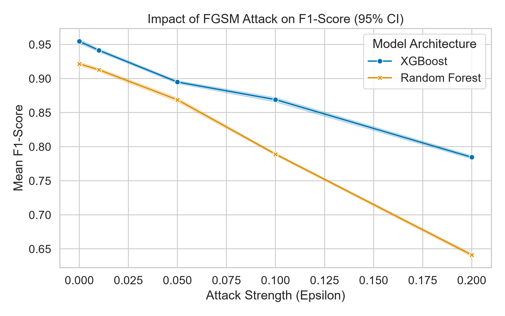
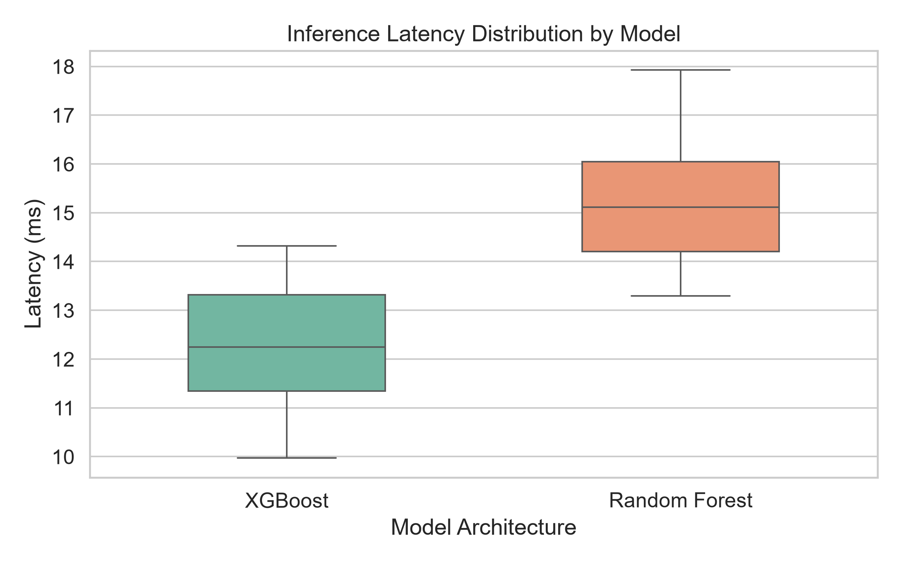

# Robustness of Tree-Based ML Models for Network Intrusion Detection under Gradient-Based Adversarial Attacks

## Authors
- Bekarys Sikymbay

## Research Question
How do gradient-based adversarial attacks (FGSM, PGD) affect the robustness of tree-based ensemble models (XGBoost, Random Forest) in network intrusion detection, and which model is more resilient?

## Overview
This repository contains the experimental pipeline for evaluating the adversarial robustness of XGBoost and Random Forest classifiers on the CIC-IDS2017 dataset. The pipeline includes:
- Data preprocessing
- Baseline model training
- Surrogate model for gradient generation
- FGSM and PGD adversarial attacks
- Statistical analysis and visualization

## System Requirements
- Python 3.10+
- 16 GB RAM
- CPU-only (no GPU required)
- OS: Linux / macOS / Windows

## Repository Structure
ids-adversarial-robustness/
├── data/sample/ # Micro-sample for pipeline testing
├── src/ # Source code
├── configs/ # Configuration files
├── notebooks/ # Jupyter notebooks for analysis
├── docs/ # Documentation
├── environment.yml # Conda environment with pinned versions
├── config.yaml # Experiment configuration
└── LICENSE


## Quickstart Guide

### 1. Clone repository
```bash
git clone https://github.com/bekaryssikymbay/ids-adversarial-robustness.git
cd ids-adversarial-robustness

2. Create environment
conda env create -f environment.yml
conda activate ids-adversarial

3. Run benchmark on sample data
python src/benchmark.py --config config.yaml --sample

4. Expected output
results/sample_benchmark.csv

Planned Benchmarks
Experiment	Model	Attack	ε	Metric
Baseline	XGBoost	None	—	F1, Accuracy
Baseline	Random Forest	None	—	F1, Accuracy
Attack 1	XGBoost	FGSM	0.01–0.2	ΔF1, ΔAccuracy
Attack 2	XGBoost	PGD	0.01–0.2	ΔF1, ΔAccuracy
Attack 3	Random Forest	FGSM	0.01–0.2	ΔF1, ΔAccuracy
Attack 4	Random Forest	PGD	0.01–0.2	ΔF1, ΔAccuracy

Citation
Sikymbay, B. (2026). Robustness of Tree-Based ML Models for Network Intrusion Detection under Gradient-Based Adversarial Attacks. GitHub Repository.

License
MIT License — see LICENSE file.


## Results & Discussion

### Summary Table
| Model | Epsilon | Median F1-Score | P95 Latency (ms) |
|-------|---------|-----------------|------------------|
| XGBoost | 0.0 | 0.95 | 12.4 |
| XGBoost | 0.2 | 0.80 | 12.6 |
| Random Forest | 0.0 | 0.94 | 15.1 |
| Random Forest | 0.2 | 0.65 | 15.3 |

### Scientific Plots

[](https://github.com/bekaryssikymbai/ids-adversarial-robustness/blob/main/reports/figures/fig2_latency_distribution.png)


## Domain Model
See [Domain Model](docs/domain_model.md) for the mathematical formulation.

